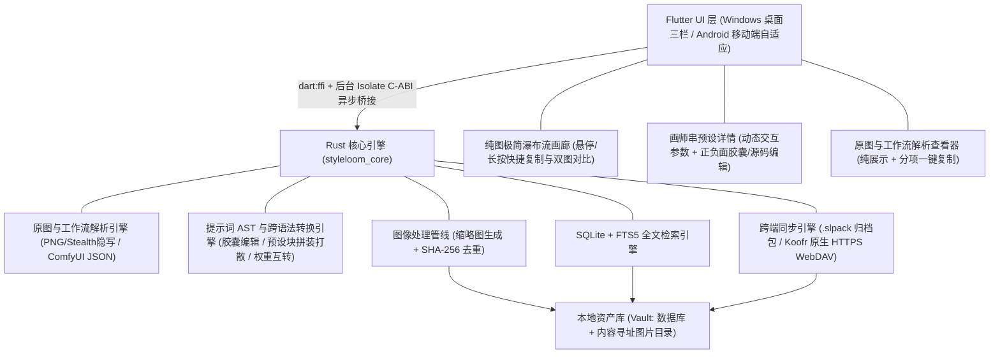
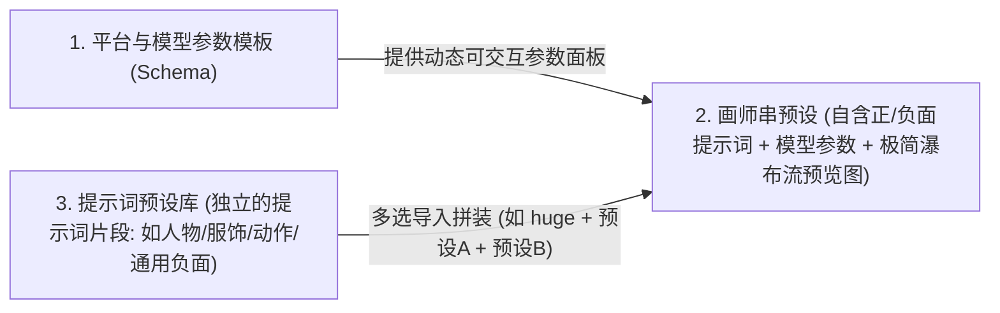

# StyleLoom 产品调研、核心技术架构与需求对齐方案书

> **文档版本**：`v1.0`（正式定稿开工版）  
> **正式名称**：`StyleLoom`（画风织机）
> **目标平台**：Windows 桌面端 + Android 移动端 / 平板端  
> **正式内核**：`Flutter + Rust`（`dart:ffi` 后台 Isolate 零代码生成桥接） + `SQLite (FTS5)`  
> **当前状态**：`v1.0` 已定稿并启动工程研发（M1–M4）

---

## 一、 同类产品与开源生态调研

在确定内核与功能边界之前，先对目前 AI 绘画社区中常见的“提示词管理、图片元数据解析与瀑布流图库”产品进行拆解，明确我们可以借鉴的设计范式以及真正有价值的切入空白：

| 代表项目 / 产品 | 定位与形态 | 值得借鉴的关键机制 | 与本产品需求的核心差距 |
| :--- | :--- | :--- | :--- |
| **`looyun/spell`** (`looyun.github.io`) & **`Akegarasu/stable-diffusion-inspector`** (`spell.novelai.dev`) | 纯本地运行的 AI 图片“魔法咒语”解析标杆（Vue / TypeScript Web 工具） | 1. **零上传本地解析**：纯客户端读取 EXIF / PNG `tEXt`、`zTXt`、`iTXt` 块与 NovelAI **`stealth_pnginfo` 隐写**； 2. 清晰分栏展示提取出的正负面提示词、模型与各项采样参数，并提供快捷复制。 | 定位为纯解析查看网页，无本地持久化配方库、无瀑布流多图对比、无参数可交互调节与积木式提示词预设库。 |
| **`Rookie_tools`** (`YukiChisaki/Rookie_tools`) | 本地 Web 工具箱 | 1. 瀑布流卡片展示画风配方与一键复制； 2. 类 `PromptAllInOne` 词条拼接与权重微调体验。 | 依赖浏览器 `IndexedDB` 存储，大批量高清预览图跨设备迁移和容量受限；缺乏 Android 原生体验；参数为静态文本，缺乏跨模型动态可交互调参面板。 |
| **`梦匣 (Monxia)`** | 开源画师与 Tag 管理工具 | 支持上传预览图、记录备注、快速组词与不同模型格式复制。 | 偏重单画师词条字典，未把「正面词 + 负面词 + 模型 + 动态可交互参数 + 预览图」作为完整配方卡片管理。 |
| **`SD Prompt Reader`** (`receyuki`) | 跨平台元数据解析器（桌面/CLI/ComfyUI 节点） | 极全的格式兼容能力：支持 A1111 `parameters`、NovelAI 标准 PNG Chunk 与 `stealth_pnginfo` 隐写、ComfyUI `workflow`/`prompt` 节点图、InvokeAI、Draw Things 等。 | 定位为单图解析/转换器，不提供个人资产库、瀑布流预览对比、动态参数交互面板与可拼接提示词片段库。 |
| **`Eagle` / `TagStudio` / `Hydrus`** | 通用/标签向本地视觉资产库 | `Eagle` 的极简纯图瀑布流手感、多级标签筛选与快速检索是桌面图库标杆；`TagStudio` 与 `Hydrus` 拥有极强的多维 Tag 数据库能力。 | `Eagle` 闭源付费且无全功能 Android 端；三者都不懂 AI 生图各平台底模的**动态交互参数面板**，也无法将正负面词拆解为可视化胶囊调权与跨语法转换。 |

> [!TIP]
> **我们的核心切入点（产品定位定稿）**  
> 打造一款 **Windows 与 Android 双端互通、纯图极简瀑布流、完全本地离线可控** 的「完整生图画风配方与积木式提示词工作台」：将 **画师串预设（完整正负面词 + 平台模型 + 动态可交互参数 + 预览图）**、**提示词预设（独立可组合的提示词片段库）** 与对标 `looyun/spell` 的 **独立原图/工作流解析查看面板（清晰展示 + 分项复制）** 融为一体，辅以 **Koofr WebDAV + `.slpack` 双端增量同步**。

---

## 二、 主流生图平台与 2026 模型参数差异调研（首批内置范围已冻结）

通过对 NovelAI 最新代际以及 ComfyUI 2025–2026 主流二次元/混合模型的调研，各平台与各模型在**提示词语法、核心参数项、推荐安全范围、特异开关**上存在显著结构性差异（以下首批内置模板范围已确认冻结，后续可随时在应用内自定义扩充）：

| 平台 / 模型 | 提示词与权重语法特征 | 核心可交互参数与推荐基准 | 平台 / 模型特异项（Schema 驱动动态渲染） |
| :--- | :--- | :--- | :--- |
| **NovelAI Diffusion V5** | 支持 Danbooru Tag 与多语言自然语言（含中日英自然描述）；数值权重 **`1.5::tag::`** / `0.5::tag::`（兼容 `{}`/`[]`，且 `::` 可一键闭合未配对括号）；鼓励极简负面词（UC）。 | • **Steps**：`28–35`（注：Opus 档标准尺寸下 `≤28` 步不扣 Anlas 点数） • **Prompt Guidance (Scale)**：`5.0–6.5`（过高易过饱和） • **Sampler**：`DPM++ 2M`、`Euler_a` 等 | • **Built-in Quality Tags** 开关（开启时避免重复堆砌 `masterpiece`） • **Prompt Guidance Rescale**（高引导防过曝补偿） • **Decrisper** 开关 • **SMEA / SMEA DYN**（高分辨率防多头防崩开关） • **Character Positioning**（支持最多 22 个角色分区框备注） |
| **NovelAI Diffusion V4.5 / V3** | V4.5 增强了多角色理解与文字排版；V3 更依赖传统 `{}`/`[]` 与靠前权重排序；同套画风配方在 V3 / V4.5 / V5 间发色与笔触差异明显。 | • **Steps**：`28` 左右为主 • **Guidance**：`5.0–6.5`（V4.5）/ `5.0–7.0`（V3） • **Sampler**：`Euler_a`、`DPM++ 2M` | • 配合“一卡一模型”原则：同配方在 V3 / V4.5 / V5 的调参卡片直接在瀑布流并排对比 • **Vibe Transfer** 参考图强度/信息提取度备注 |
| **ComfyUI · Anima**（CircleStone Labs × Comfy Org，2B Cosmos + Qwen3-0.6B） | 支持 Danbooru Tag 与自然语言混合输入；支持 **`@artist`** 格式或自然语言风格描述；无需堆砌大量冗余质量词与超长负面词。 | • **Base / Aesthetic 版**：Steps `20–30`，CFG `3.5–6.5` • **Turbo 蒸馏版**：Steps `8–12`，CFG `1.0–2.0` • **Sampler**：`Euler`、`DPM++ 2M`（及 SDE 变体） • **Scheduler**：`Normal`、`Karras`、`Beta` | • **Base vs Turbo 变体切换**：蒸馏版与基础版的安全 CFG/Steps 区间完全不重叠，参数面板随子型号联动提示安全区间 |
| **ComfyUI · MOSS-Image**（5B 单流 DiT + Qwen3.5-9B + FLUX.2 VAE） | Flow-Matching 架构，默认偏写实，二次元出图**必须显式声明媒介前缀**（如 `Anime-style digital illustration`）；Tag 推荐**去下划线转自然空格**（`long hair` 而非 `long_hair`）；支持长自然句（最高 4K tokens）。 | • **Steps**：`25–50`（配合 Turbo LoRA 可降低） • **CFG**：`2.5–3.0` • **Sampler**：`Euler`（Flow-Matching） • **常见尺寸**：`1024x1024`、`832x1216`、`1216x832` | • **Flow Shift** 参数（推荐 **`5`**） • **动漫风格 LoRA 栈 + Trigger Words**（如 `d3style` 权重 `0.8–1.0`） • **SLG (Skip Layer Guidance)** / 去油腻修正 LoRA 标记 • **Prompt Enhancer** 开关（记录是否经过 LLM 自动扩写） |
| **ComfyUI · Illustrious XL / NoobAI-XL**（SDXL / V-Pred 系） | 强依赖严格逗号 Tag 与开头分数/分级前缀（如 `masterpiece, best quality, very aesthetic, rating_general`）；标准圆括号权重 `(artist:xxx:1.2)`。 | • **Steps**：`20–28` • **CFG**：`3.0–5.0`（低于常规 SDXL 以免色彩过饱和） • **Sampler**：`Euler a`、`DPM++ 2M` • **Scheduler**：`Karras`、`SGM Uniform` | • **Prediction Type** 关键切换（`Epsilon` vs **`V-Prediction`**，NoobAI V-Pred 选错会直接出图崩坏） • 分辨率常用 `1024x1024` / `832x1216` / `768x1344` |
| **ComfyUI · Lumina-Image 2.0 / Chroma**（Flow DiT / Flux 衍生） | Lumina 2 偏自然语言描述；Chroma（8.9B + `t5xxl`）兼容长描述与艺术风格词。 | • **Chroma 默认基准**：Steps `26`，CFG `3.5` • **Lumina 2**：Flow DiT 采样参数 | • **Lumina 2 System Prompt 预设**（`superior` / `alignment`） • **Chroma Radiance Options**（`start_sigma`、`end_sigma`、`nerf_tile_size`、`force_sequential_txt_ids`） |
| **通用 WebUI / Forge & 用户自定义** | 标准 A1111 `(tag:1.2)` / `[tag]` 语法，支持扩展自建方言。 | • 通用 Steps / CFG / Sampler / Scheduler / Seed / 宽高 | • 支持在 UI 内一键克隆已有 Schema 或新增任意新平台/新模型参数项 |

### 核心架构：Schema 驱动的可交互动态参数引擎

1. **模板声明式定义 UI 控件**：每个平台/底模在底层以 JSON Schema 描述自己拥有哪些参数，以及每个参数的控件类型（`slider` 滑块、`stepper` 步进器、`select` 下拉枚举、`toggle` 开关、`resolution` 宽高预设、`lora_list` LoRA 槽位列表、`text` 短文本如 Trigger Word）。
2. **推荐安全区间高亮**：例如在 `NAI V5` 下 `Steps` 滑块在 `28` 处可标出“Opus 免点线”，在 `Anima Turbo` 下 `CFG` 超过 `2.0` 给出温和提示，`MOSS-Image` 面板直接显现 `Shift` 滑块与风格 LoRA 槽，切换到 `Illustrious` 时自动显现 `Prediction Type` 与 `Scheduler`。
3. **内置预设 + 用户全自由自定义**：开箱内置上述主流平台与模型模板；同时用户在界面上可以随时**克隆、修改已有模型模板，或新建自定义平台与自定义参数项**。

---

## 三、 正式技术内核选型与解析查看器架构

### 3.1 候选跨端技术栈对比

| 评估维度 | **`Flutter + Rust (dart:ffi)`（正式内核）** | 纯 `Flutter (Dart)` | `Tauri v2 (Rust + WebView)` | `Kotlin Compose Multiplatform (KMP)` |
| :--- | :--- | :--- | :--- | :--- |
| **Android 瀑布流滚动帧率与手势** | **极佳**：Impeller/Skia 直接 GPU 绘制原生画布，`SliverMasonryGrid` 视口回收稳定 60–120 FPS，无 DOM 重排卡顿。 | **极佳**（同左边 UI 层表现）。 | **一般 / 易踩坑**：依赖系统 Android WebView，大量不等高图片瀑布流快速滑动时 DOM 回收与触控惯性调优成本较高。 | **好**：Android 原生，但跨桌面与图像生态组件不如 Flutter 成熟。 |
| **Windows 桌面体验** | **优秀**：独立桌面编译，原生支持窗口多栏排版、文件拖入（`desktop_drop`）、鼠标悬停与快捷键。 | **优秀**（同左边 UI 层表现）。 | **优秀**：WebView2 轻量，包体积小（~10MB 级）。 | **一般**：桌面端主要走 JVM/Skiko，打包分发和生态不如前两者顺手。 |
| **图片隐写解析 & 缩略图性能** | **顶尖**：Rust 直接操作字节流解析 PNG Chunk、`stealth_pnginfo` LSB 隐写与 Gzip 解压，无 GC 停顿；配合多线程与纯 Rust 图像管线生成轻量缩略图。 | **较弱**：Dart 处理逐像素 LSB 位提取、Gzip 解压与大图缩略图重采样时 CPU 与 GC 内存波动较大，容易卡顿 UI Isolate。 | **顶尖**（同左 Rust 内核），但前端读取大量本地缩略图需经过 WebView 自定义协议桥接，开销略高于 Flutter 原生图片管线。 | **中上**：需借助 JNI 调 C/Rust 才能拿到同等图像处理速度。 |
| **WebDAV 增量同步与双端数据库同构** | **顶尖**：Rust 侧单一 `rusqlite`（SQLite + FTS5 全文检索）+ `ureq` 纯 Rust HTTPS WebDAV，Windows 与 Android 共享 100% 同一套存储与同步代码。 | 需靠 Dart 插件，核心解析与同步逻辑难以跨引擎复用。 | **优秀**：同左 Rust 内核。 | Android 与桌面端文件/SQLite 驱动适配较繁琐。 |

### 3.2 正式内核模块边界

**正式确定采用 `Flutter`（前端 UI 交互层） + `Rust`（核心业务引擎，通过零代码生成的 `dart:ffi` + 后台 Isolate C-ABI 桥接 `styleloom_core.dll` / `libstyleloom_core.so` 通信）作为 StyleLoom 的技术内核**，彻底消除外部桥接代码生成器的跨平台版本脆弱性。

### 3.3 原图 PNG（含 `stealth_pnginfo`）与 ComfyUI `.json` 解析查看器（已锁定：展示 + 复制模式）

- **不强行自动拆串入库**：从 PNG 与 ComfyUI 工作流中提取完整的正/负面提示词、底模、采样器、CFG、步数可以做到精确还原；但混在通用词或自然语言长句中的“画风修饰”与“单图特定人物动作衣着词”难以完美自动分割，因此不强行自动建预设。
- **Spell Inspector 独立解析面板（对标 `looyun/spell` & `Akegarasu/stable-diffusion-inspector`）**：
  1. **标准元数据块**：极速零解码读取 PNG `tEXt` / `iTXt` / `zTXt` 与 JPEG/WebP EXIF，识别 NovelAI `Description` + `Comment` JSON（V3/V4.5/V5）、A1111/Forge `parameters` 文本块、ComfyUI 内嵌 `prompt`/`workflow`；
  2. **`stealth_pnginfo` 隐写解析**：当普通 PNG 文本块缺失时，自动按列优先坐标（`x: 0..width-1`, `y: 0..height-1`）扫描 Alpha 通道（`stealth_pnginfo` / `stealth_pngcomp`）或 RGB 通道（`stealth_rgbinfo` / `stealth_rgbcomp`）的最低有效位（LSB），校验魔数头与 32 位大端长度后 `flate2` Gzip 解压还原完整信息；
  3. **ComfyUI `.json` 工作流回溯**：兼容 UI 导出格式（`nodes` + `links`）与 API 格式，从采样器节点自动回溯上游提取 Checkpoint/UNET 模型、LoRA 链、`Flow Shift`、采样器、调度器、Steps、CFG 及正负面提示词（多采样器工作流支持点击切换查看不同阶段）；
  4. **纯展示 + 分项一键复制**：拖入、选择或手机系统分享进来后，清晰分栏展示所有解析字段与参数，每项旁提供 **「复制」按钮**，同时支持快捷「以此图作为封面并带入参数去新建画师串预设」；论坛纯文字分享同样支持直接粘贴录入预设表单。

---

## 四、 核心业务模型拆解（已彻底对齐）

> [!NOTE]
> **核心名词最终定义**  
> - **画师串（画师串预设）** ＝ 卡片自身保存的 **正面提示词** ＋ **负面提示词** ＋ **平台与模型** ＋ **可交互模型参数** ＋ **预览效果图**（完整画风生图配方包）。  
> - **提示词预设** ＝ 独立的、可任意复用的 **「提示词片段（Prompt Snippet）」**，不预设正/负面属性（可以是人物描述、身材特征、光影词、也可以是常用负面词），可自由组合导入到画师串的正面或负面提示词中。

### 4.1 「一卡一模型」画师串预设（核心瀑布流资产）
1. **卡片自持数据（废弃自动建正负面预设逻辑）**：每张画师串卡片直接存储自己的 **名称、标签、预览图组（1 张瀑布流封面 + 可选对比附图）、所属平台与模型、动态参数值、正面提示词、负面提示词**；不再强制要求关联或自动生成 `<画师串预设名>-正/负面提示词`。
2. **多模型独立卡片并排对比**：同一套配方在 `NAI V4.5`、`NAI V5` 或 `ComfyUI Anima` 上测试出不同参数和效果时，**拆分为多张独立卡片**并在瀑布流并排对比差异；任意卡片支持一键「克隆到其他模型」并自动转写提示词语法。

### 4.2 提示词预设（独立的「提示词片段」积木库）
- **中性片段定位**：每条「提示词预设」只包含 **名称、自定义分类标签（如 `人物主体`、`画质起手`、`服饰姿势`、`光影氛围`、`常用负面` 等）、适用模型备注、以及一段提示词内容**，支持胶囊/源码双模编辑。
- **积木式导入组合（方案 B：预设胶囊块 + 可一键打散，已锁定）**：
  - 例如库中有：`提示词预设 A = 1girl, beautiful`，`提示词预设 B = huge breasts`；
  - 你的某个画师串卡片正面提示词原本写了 `huge`；
  - 在该画师串卡片编辑/详情区点击 **「导入提示词预设」**，多选勾选 `预设 A` 与 `预设 B` 后，编辑区会以独立高亮块呈现为：**`[huge]` ＋ `[🧩 预设 A]` ＋ `[🧩 预设 B]`**；
  - **动态联动与整块操作**：`[🧩 预设名]` 胶囊块支持整块拖拽调整前后顺序、整块点击“临时屏蔽”或移除；当修改 `预设 A` 原件内容时，引用的卡片输出同步生效；一键复制时自动按英文逗号衔接展开输出 **`huge, 1girl, beautiful, huge breasts`**（自动跳过被屏蔽块/词条）；
  - **一键打散**：如果你想针对当前卡片单独修改预设内部某个词条或权重，点击该预设块上的 **「打散」** 图标，即可原地将其拆解为普通单字词条胶囊，与其他词条毫无差别地微调。

### 4.3 胶囊 ↔ 纯文本双模编辑器 & 跨平台权重语法转换复制（已锁定）
1. **可视化胶囊 ↔ 纯文本源码一键切换**：
   - 正/负面提示词编辑区支持在「胶囊模式」与「纯文本源码模式」间无损互切；
   - 胶囊模式下支持 **拖拽调序**、点击 **`±0.05` 增减权重**、点击 **「临时屏蔽」图标**（屏蔽后胶囊变灰并加删除线，**复制输出时自动剔除该词条**，但不从配方中删除）。
2. **复制与「转换目标权重语法后复制」**：
   - 正/负面提示词旁分别提供 **「复制」主按钮**（按当前模型原格式输出并自动跳过被屏蔽词条）以及 **「转换格式后复制」辅助按钮**；
   - 点击转换复制后可快速选择目标语法方言：`NAI V4.5/V5 (1.2::tag::)`、`NAI 旧括号 ({tag})`、`SDXL/ComfyUI ((tag:1.2))`、`Anima (@artist)`、`MOSS (去下划线转空格)`，Rust AST 引擎即时转换后写入剪贴板。

---

## 五、 纯图极简瀑布流与快捷交互设计（已锁定）

为了在浏览不同画师串时获得像专业画廊一样的纯粹视觉对比体验，瀑布流界面确立为 **纯图极简风**（无多余文字摘要，无模糊隐私遮罩开关），同时在卡片表面保留高效率的悬停/长按快捷复制：

- **纯图极简外观**：每张卡片保留原图宽高比铺满画面，仅在角落呈现轻量半透明的模型角标（如 `NAI V5` / `Anima`）与名称。
- **表面快捷交互（已锁定）**：
  - **Windows 桌面端**：鼠标**悬停**在卡片上时，底部/角落浮现半透明快捷栏，直接提供 **「复制正面提示词」**、**「复制负面提示词」**（附带小箭头可直接选「转语法复制」）与「查看详情」；单击图片直接打开右侧抽屉面板，查看多图对比、交互调节模型参数与胶囊编辑。
  - **Android 移动端**：支持双指捏合调节 1~4 列瀑布流密度；**轻点**卡片进入详情与调参页，**长按**卡片直接弹出底部快捷菜单，一键点选 **「复制正面提示词 / 复制负面提示词 / 转换语法复制 / 克隆卡片」**；支持从其他应用 **「分享到 StyleLoom」** 唤醒 Spell Inspector 解析查看面板。

---

## 六、 双端数据同步架构与工程交付方案（已锁定）

1. **离线归档包（`.slpack`）**：支持「全库导出」或「勾选多张卡片与提示词预设导出分享包」（ZIP 容器内含 `manifest.json`、完整词条、自定义 Schema 与原图），双端文件互传一键导入并按图片 `SHA-256` 自动去重。
2. **原生 HTTPS WebDAV 增量同步（内置 Koofr 快捷配置 + 通用 WebDAV）**：
   - Rust 内核使用纯 Rust `ureq` + `rustls` 原生发起 WebDAV 请求，无外部 OpenSSL C 依赖，彻底绕开 Windows 系统原生 WebDAV 映射 50MB 单文件大小限制；
   - **内置 Koofr 快捷预设**：默认端点自动填充 **`https://app.koofr.net/dav/Koofr`**（端口 `443` HTTPS，路径区分大小写），引导填写账号邮箱 + **应用专用密码（App Password）** + 远端目录（默认 `/StyleLoom`），内置连接测试；同时支持任意第三方 WebDAV（坚果云、NAS、Alist 等）；
   - **内容寻址增量协议**：图片按 `SHA-256` 存入 `blobs/` 永不重复上传，结构化记录压缩存 `records/snapshot.json.gz` 并按时间向量增量合并，冲突时保留双份不丢数据。
3. **双端构建验证分工**：Android `.apk`、Linux 桌面端与 Rust 全套单元测试在当前 Linux 工作站验证产出；Windows 端代码保持 100% MSVC 与桌面插件兼容并配齐一键构建脚本（`scripts/build-windows.ps1`），由你在自有 Windows 设备编译测试。

---

## 七、 分阶段研发路线图（`v1.0` 已定稿开工）

1. **M1 — 工程骨架与 Rust 核心引擎**：初始化 `dart:ffi` 零代码生成跨端工作区；完成 SQLite + FTS5 数据库与迁移；实现 PNG Chunk + `stealth_pnginfo` + ComfyUI `.json` 解析引擎、提示词胶囊 AST（含 `SnippetRef` 预设胶囊块与一键打散）及多平台语法转换器、以及全套 Rust 单元测试。
2. **M2 — 纯图极简瀑布流与动态 Schema 参数面板**：落地首批内置平台/模型 Schema（NAI V5/V4.5/V3、Anima Base/Turbo、MOSS-Image、Illustrious/NoobAI、Lumina 2/Chroma、WebUI）及自定义 Schema 编辑器；完成 Windows 三栏与 Android 极简瀑布流、卡片悬停/长按快捷复制菜单与多图对比。
3. **M3 — 提示词预设片段库、胶囊编辑器与 Spell Inspector**：完成独立的「提示词预设」片段库与向画师串正/负面导入 `[🧩 预设名]` 胶囊块（含一键打散）组合流；完成可视化胶囊（拖拽/`±0.05`/临时屏蔽）↔ 纯文本双向编辑及「转换目标权重语法后复制」；完成独立「Spell Inspector 原图与工作流解析查看面板（纯展示+分项复制）」与 Android 系统分享入口。
4. **M4 — `.slpack` 离线包 + Koofr WebDAV 同步与双端交付**：完成内容寻址 WebDAV 增量同步（内置 Koofr 连接测试）及 `.slpack` 导入导出；输出 Android `.apk` 并提供完整 Windows 构建脚本供实机测试。

---

## 八、 需求讨论与决策记录表

### 8.1 已锁定核心决策（共 12 项 ✅ · 方案书 `v1.0` 正式定稿）

| 编号 | 议题 | 最终确认结论 | 状态 |
| :--- | :--- | :--- | :--- |
| **Q1** | **项目定名与目录** | **`StyleLoom`** | `✅ 已锁定` |
| **Q2** | **画师串预设的核心定义** | **自身直接保存正面提示词 + 负面提示词 + 平台与模型 + 可交互参数 + 预览效果图** | `✅ 已锁定` |
| **Q3** | **多模型对比方式** | 同配方在不同模型下的参数与效果**拆分为多张独立卡片**，在瀑布流并排对比 | `✅ 已锁定` |
| **Q4** | **提示词预设定位与拼装方式** | 独立的 **「提示词片段（Prompt Snippet）」** 积木库，不强分正负；废弃自动建 `<画师串预设名>-正/负面提示词`，支持在画师串正/负面词中多选导入拼接组合 | `✅ 已锁定` |
| **Q5** | **原图 PNG / ComfyUI JSON 解析定位** | 独立 **Spell Inspector 解析查看面板**（对标 `looyun/spell` 与 `stable-diffusion-inspector`，含 `stealth_pnginfo`），**只清晰展示并提供分项复制按钮，不强行自动导入** | `✅ 已锁定` |
| **Q6** | **首批内置平台/模型范围** | NAI (V5/V4.5/V3)、ComfyUI (Anima/MOSS/Illustrious/NoobAI/Lumina/Chroma)、通用 WebUI/Forge + 自定义扩展 | `✅ 已锁定` |
| **Q7** | **提示词编辑器形态** | **「可视化胶囊（拖拽排序 / `±0.05` 调权 / 临时屏蔽单个词条）↔ 纯文本源码一键切换」** | `✅ 已锁定` |
| **Q8** | **复制与跨平台语法转换** | 自动跳过被屏蔽词条，提供原样复制与辅助的 **「转换目标权重语法后复制」** | `✅ 已锁定` |
| **Q9** | **瀑布流视觉风格与表面快捷菜单** | **纯图极简风**瀑布流（无模糊遮罩开关）；**桌面悬停 / 手机长按**弹出「复制正面提示词 / 复制负面提示词」快捷菜单 | `✅ 已锁定` |
| **Q10** | **双端同步机制** | 原生 HTTPS WebDAV 增量同步（内置 **Koofr** 快捷预设 + 通用 WebDAV）+ **`.slpack`** 离线压缩包 | `✅ 已锁定` |
| **Q11** | **Windows 端构建测试** | 提供跨 Windows + Android 完整源码与构建支持，Windows 端由用户在自有 Windows 设备编译测试 | `✅ 已锁定` |
| **Q12** | **导入提示词预设片段后的编辑态形态** | **方案 B**：以可整体拖拽/临时屏蔽/移除的 **`[🧩 预设名]` 预设胶囊块** 拼入，复制时自动按逗号展开输出，点击 **“打散”** 可拆为独立普通词条胶囊 | `✅ 已锁定` |
